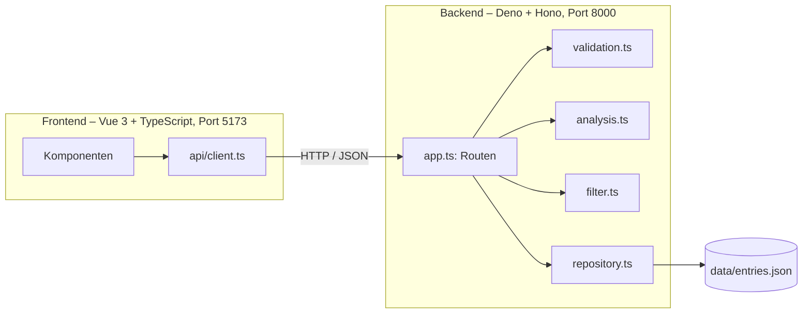
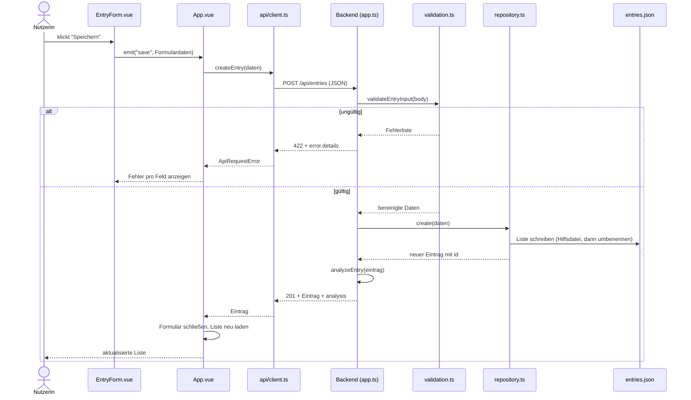
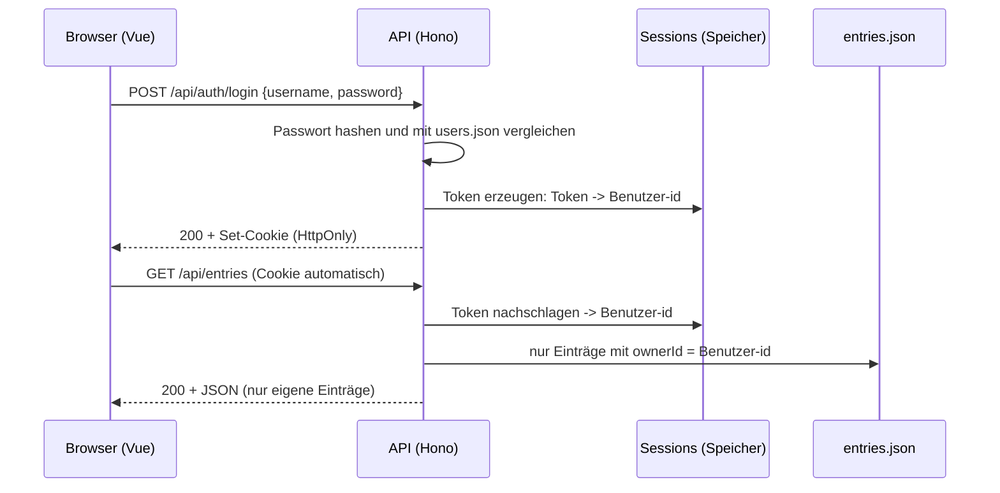

# Architektur von LabelLos

> Entwurf als Ausgangspunkt. Die Begründungen sind für das Prüfungsgespräch gedacht: Bitte jede Zeile
> verstehen und bei Bedarf in eigenen Worten anpassen.

## 1. Überblick

Frontend und Backend sind **eigenständige Programme**. Das Frontend kennt nur die REST-Schnittstelle
(Adressen, Datenformat) – nicht Hono, Deno oder die JSON-Datei. Das ist mit „entkoppelt“ gemeint.

## 2. Datenfluss: Klick auf „Speichern“

In Worten:

1. `EntryForm.vue` meldet die Eingaben per `emit("save")` an `App.vue` (die Komponente kennt die API nicht).
2. `App.vue` ruft `createEntry` (bzw. `updateEntry`) in `api/client.ts` auf.
3. `client.ts` schickt `POST /api/entries` mit JSON an das Backend.
4. `app.ts` nimmt die Anfrage an und lässt `validation.ts` prüfen (Pflichtfelder, erlaubte Werte, Datum,
   Fachregel „vegan nur mit Zutatenhinweisen und Quelle“).
5. Bei Fehlern: Status 422 mit `details` pro Feld, das Formular zeigt sie an den Feldern an.
6. Sonst schreibt `repository.ts` den Eintrag in `data/entries.json`.
7. `analysis.ts` berechnet die Zutatenprüfung, `app.ts` antwortet mit `201 Created`.
8. `App.vue` schließt das Formular und lädt die Liste neu; Vue zeichnet die Oberfläche neu.

## 3. Verantwortlichkeiten

| Teil | Verantwortung | Weiß nichts von |
|---|---|---|
| Vue-Komponenten | Darstellen, Eingaben sammeln | HTTP-Adressen, Datei |
| `api/client.ts` | Einzige Stelle mit `fetch`, Fehler übersetzen | Darstellung |
| `app.ts` | Routen, HTTP-Statuscodes, Fehlerformat | Dateiformat |
| `validation.ts` | Eingaben prüfen und bereinigen | HTTP, Datei |
| `analysis.ts` | Fachliche Zutatenprüfung | HTTP, Datei |
| `repository.ts` | Lesen/Schreiben der JSON-Datei | Validierung, Analyse |

Folge: Würde man die JSON-Datei durch eine Datenbank ersetzen, ändert sich nur `repository.ts`.
Würde man das Vue-Frontend durch eine mobile App ersetzen, bleibt das Backend unverändert.

## 4. Entscheidungen und Alternativen

| Entscheidung | Begründung | Verworfene Alternative |
|---|---|---|
| Validierung im **Backend** (nicht nur im Formular) | Jeder kann die API ohne Oberfläche aufrufen; dem Client wird nicht vertraut. Das Formular prüft nur Bequemlichkeits-Dinge (`required`). | Nur Formularprüfung: unsicher, jede andere App könnte ungültige Daten senden |
| Zutatenprüfung im **Backend** | Fachlogik an einer Stelle; jede künftige App bekommt dieselbe Prüfung. | Prüfung im Frontend: müsste in jeder App neu gebaut werden |
| Analyse wird **berechnet, nicht gespeichert** | Bleibt aktuell, wenn die Zutatenliste besser wird; keine veralteten Daten. | Speichern der Analyse: wird schnell inkonsistent |
| Fachregel: „vegan/vegetarisch“ nur mit Zutatenhinweisen **und** Quelle | Verhindert unbelegte Behauptungen; ohne Belege bleibt „unbekannt“. | Alles erlauben: App würde Sicherheit vortäuschen |
| Treffer sind **Hinweise mit Begründung**, kein Beweis; kein Treffer ≠ vegan | Die Liste ist klein und unvollständig; Wortvergleiche können falsch liegen (z. B. „Hafermilch“). | Automatisch „vegan“ setzen bei 0 Treffern: gefährlich |
| Kein Filter „ohne Allergen“ | Fehlende Angabe ≠ allergenfrei. | Filter „ohne Allergen X“: würde Sicherheit suggerieren |
| JSON-Datei als Persistenz | Einfach, Architektur bleibt sichtbar, passt zum kleinen Umfang. Atomares Schreiben (Hilfsdatei + Umbenennen) und eine Warteschlange gegen gleichzeitige Schreibzugriffe. | SQLite/Datenbank: mehr Konfiguration, für diesen Umfang nicht nötig |
| Handgeschriebene Validierung statt Bibliothek (z. B. Zod) | Keine zusätzliche Abhängigkeit, jeder Schritt ist lesbar und erklärbar. | Zod: weniger Code, aber eine Abhängigkeit mehr |
| `PUT` statt `PATCH` | Formular schickt immer alle Felder; einfacher und eindeutiger. | `PATCH`: sinnvoll bei Teiländerungen, hier nicht nötig |
| Feste Listen für Kategorie und Allergene | Eindeutige Filter, keine Tippfehler. Allergene = die 14 EU-Gruppen. | Freitext: schlecht filterbar |
| Frontend hat **eigene Kopie** der Typen | Echte Entkopplung: kein gemeinsamer Code, der Vertrag ist die API. Nachteil: Änderungen müssen an zwei Stellen erfolgen. | Gemeinsames Paket / OpenAPI-Generator: mehr Aufbau |
| Reines CSS, keine UI-Bibliothek | Wenig Abhängigkeiten, volle Kontrolle über Kontraste und Fokus. | Bootstrap: schneller, aber mehr Fremdcode |
| Berechtigungen für Deno eingeschränkt (`--allow-read=data` usw.) | Das Backend darf nur, was es braucht (Prinzip der geringsten Rechte). | `--allow-all`: bequem, aber unnötig offen |

## 5. Barrierefreiheit (Auswahl)

- Jedes Feld hat ein sichtbares `<label>`; Gruppen (Allergene, Einstufung) sind `<fieldset>` mit `<legend>`
- Fehler stehen am Feld (`aria-describedby`, `aria-invalid`) und allgemein in `role="alert"`
- Bedeutung steckt im Text, nicht nur in Farbe (Einstufungs-Etikett)
- Sichtbarer Fokus, „Zum Inhalt springen“-Link, Bedienung komplett per Tastatur
- Statusmeldungen („gespeichert“, „gelöscht“) über `aria-live`
- Respektiert „weniger Bewegung“ (`prefers-reduced-motion`)

## 6. Bekannte Grenzen (Ansatz für die Reflexion – bitte selbst ergänzen)

- Die Zutatenliste ist klein; sie erkennt nur bekannte Wörter und kann sich irren
  (Beispiele: „veganer Käse“ wird als Milchprodukt markiert; Wörter wie „Aroma“ bleiben unerkannt)
- JSON-Datei: nicht für viele gleichzeitige Nutzer:innen gedacht, kein Suchindex
- Kein Login: Jede:r darf alles ändern und löschen
- Keine automatisierten Tests für Frontend und HTTP-Routen (nur Logik-Tests im Backend)

## 7. Übungsfragen fürs Prüfungsgespräch

1. Was passiert genau, wenn ich auf „Speichern“ klicke? (Abschnitt 2 ohne Nachsehen erzählen)
2. Warum prüft das Backend, obwohl das Formular schon prüft?
3. Was würde passieren, wenn wir das Vue-Frontend durch eine mobile App ersetzen?
4. Warum gibt es `repository.ts`? Was müsste sich bei einer echten Datenbank ändern?
5. Warum bedeutet „kein Treffer“ nicht „vegan“?
6. Was ist CORS, und warum brauchen wir es hier?
7. Was bedeuten die Statuscodes 201, 204, 404 und 422?
8. Welche Alternative haben wir bei Entscheidung X verworfen, und warum?

## Ergänzung: Anmeldung und Datentrennung

